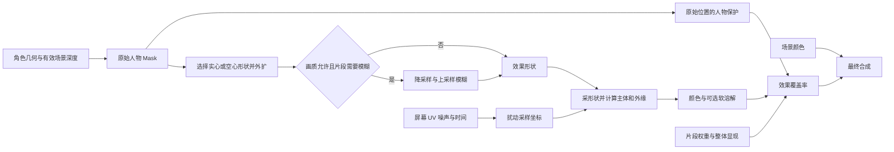

# 屏幕空间人物 Mask、扰动描边与软边参考

> 类型：REFERENCE；适用范围：由人物遮罩驱动的火焰、能量、灵体、魔法外缘及全屏后处理；使用前提：以目标项目代码、资产和版本重新验证。
>
> 本文解释图像与几何的实现方式；性能、预设、资产迁移和工具见 [制作与验证参考](screen-space-effect-production-and-validation.md)，实际工程落点与验证证据见 [ProjectACG Profile](../Profiles/ProjectACG/custom-post-processing-outline.md)。本文不另建强制规则。

## 1. 适用场景

目标是让角色周围出现会流动、扭曲、分色并可柔化的轮廓，而角色本体保持清晰。常见需求包括实心人物 Mask 输入、空心描边输入、镜头远近变化、Timeline 淡入淡出，以及按设备档位开启额外模糊。

先把视觉要求拆成可独立观察的部分：

| 观察项 | 实际控制对象 | 首选检查位置 |
| --- | --- | --- |
| 火焰的长度、方向、流动 | 采样坐标位移及噪声时间变化 | 扰动方向、强度、纹理与滚动 |
| 主体厚度与外圈颜色 | 形状扩张、主体/外缘分解及 Alpha | 形状算法与两种颜色 |
| 伸向背景的软边 | 效果形状的连续覆盖率 | Mask 滤波、模糊、阈值曲线 |
| 贴近人物的位置 | 原始人物保护遮罩 | 保护阈值、深度判定、低分辨率空洞 |
| 溶解孔洞的软边 | 溶解函数新产生的覆盖率 | 溶解噪声、阈值和过渡宽度 |
| 明亮光晕 | HDR 颜色进入后续 Bloom 的能量 | 渲染时序、颜色和后处理 |

换贴图可以改变已有算法的空间分布、频率与运动观感。若缺少形状外扩、两色分解、连续 Alpha 或独立人物保护，换贴图不能补出这些计算。先确认缺的是数据还是算法，再决定调材质或修改 Shader。

## 2. 前提与依赖

按 [Shader 模块入口](../README_Tech_URPShaderDevelopmentRules.md) 的 `DOC-03`、`CMP-01`、`ARC-03`、`ARC-04` 核对以下事实。

| 契约 | 开始实现前记录的内容 |
| --- | --- |
| 参考效果 | 同一动作的若干时刻；主体保护、外扩、流动、透明度、颜色和 Bloom 分开判断 |
| 相机 | 投影方式、FOV、实际输出尺寸、Viewport、动态分辨率、相机堆叠与目标平台 |
| 几何来源 | 目标 Renderer/SubMesh、骨骼更新、顶点变形、Alpha Clip 和双面规则 |
| 遮挡策略 | 是否被场景遮挡；使用哪个阶段的深度；透明物体是否写入该深度 |
| 资源协议 | 每张 RT 的生产者、格式、过滤、尺寸、UV 空间、消费者、无效值与销毁方 |
| 合成 | 是否采场景色、是否保留场景 Alpha、是否依赖后续 Bloom/Tone Mapping |
| 动态控制 | 全局画质、片段参数、材质参数分别由谁写，何时恢复 |

独立 override material 重画角色是一种 Mask 生产方式；它与复用角色自身的反向外扩描边 Pass 是两条不同链路。前者容易控制实心覆盖和 RT，后者可能已经包含法线外扩、Cull、顶点动画或材质裁剪，不能按“都叫描边”视为等价。透明发梢、镂空服装、GPU 顶点变形需要额外验证 Mask 与主画面的几何一致性。

渲染时序及共享状态细则沿用 [RendererFeature 状态与时序参考](renderer-feature-stencil-and-timing.md)；材质生命周期与溶解空间沿用 [溶解参考](dissolve-space-threshold-and-material-lifecycle.md)。

## 3. 实现或排查步骤

### 3.1 先画出实际信号链



“先模糊再传入效果 Shader”指生成效果形状 RT 后，由额外 Pass 写出模糊 RT，主合成 Pass 才采它计算扰动、分色等内容。模糊函数也可以与主效果放在同一 `.shader` 文件的不同 Pass 中；代码位于同一个文件，不表示每个最终像素都重新执行整条多级模糊。

每个像素在主 Pass 内做邻域模糊也是方案，但大半径会重复读取大量相邻样本。多级方案把中间结果保存下来，供后续像素复用。

特别区分两种顺序：

- 先在原始轮廓域模糊，再以扰动 UV 采样：柔化后的形状一起被拉伸，局部软边宽度随变形而变。
- 先得到扭曲结果，再模糊结果：在最终屏幕域扩散，可能抹平火焰细节。

二者通常不满足交换律；验收前确认参考效果需要哪一种。UV 整体缩放在模糊之后发生时，也会缩放模糊宽度。

### 3.2 将原始人物、效果形状和保护职责分开

| 数据 | 典型内容 | 使用方式 |
| --- | --- | --- |
| 原始人物 Mask | 几何可见覆盖，内部接近 1、背景接近 0 | 作为生成输入和保护依据 |
| 效果形状 Mask | 实心外扩或空心环带 | 决定哪里有特效 |
| 模糊效果 Mask | 效果形状滤波后的连续值 | 决定火焰外缘柔化 |
| 人物保护量 | 从未扰动的原始 Mask 重建 | 抑制角色本体上的特效覆盖 |

如果把人物保护也改为大半径模糊图，保护量会扩散到背景，常见结果是贴近人物的白色或彩色填充被吃掉。效果形状的软边宽度与保护边界的过渡宽度适合分开设计。

实心输入与最终盖住人物也不是一回事：先用实心形状生成流动外扩，再乘以 `1 - protection`，仍可只显示角色外部。保护采样保持原始位置；把保护 UV 一同扭曲会导致人物表面漏入颜色。

### 3.3 选择实心、空心与外扩方式

以下用数学变量描述通用关系，不代表任何工程的属性名。

| 方法 | 关系 | 优点 | 代价与限制 |
| --- | --- | --- | --- |
| 实心直采 | `S = M` | 不需要额外形状生成 Pass | 外扩来自后续扰动或采样偏移 |
| 邻域膨胀 | `D(u) = max M(u + offset[i])` | 便于按指定尺度扩轮廓 | 样本增加；离散方向可能有棱角与漏采 |
| 空心环带 | `H = saturate(D - M)` | 显式保留轮廓区域 | 模糊后容易丢失很窄的环带 |
| UV 整体放大 | `u' = pivot + (u - pivot) / scale` | 直接重用形状，计算便宜 | 不是等距外扩；依赖人物形状及中心 |

多个角色合并成一张 Mask，再绕合并中心缩放，会改变它们之间的关系。近处遮挡、屏幕裁切、脚底固定等需求可能要求逐角色处理或更明确的中心。

“实心形状模式”描述输入语义，“单次采样”描述纹理读取次数，二者不能混用。两色边缘分解即使只保留一种形状模式，也可能仍需多个形状样本。

### 3.4 用扰动与形状分解生成两种颜色

下面是四方向分解的算法示意。`readShape` 表示已经完成输入选择、边界处理和软化映射的覆盖率读取，输出范围为 `[0,1]`；代码不是可单独导入的 Shader。

```hlsl
float2 shiftedUV = screenUV + flowDirection * noise * amplitude;
float a = readShape(shiftedUV + float2(0, radius.y));
float b = readShape(shiftedUV - float2(0, radius.y));
float c = readShape(shiftedUV + float2(radius.x, 0));
float d = readShape(shiftedUV - float2(radius.x, 0));
float outer = max(max(a, b), max(c, d));
float core = min(min(a, b), min(c, d));
float rim = outer - core;
```

`max` 给出并集式外部覆盖，`min` 给出交集式主体，二者差值形成外缘。它是离散采样形成的风格化结构，不是连续距离场的精确等宽环。外圈默认黑色只是颜色选择；单独暴露外缘颜色和 Alpha 即可调色，没必要为换颜色另建一种遮罩算法。

若参考使用单向噪声 `n ∈ [0,1]`，直接替换成 `2n - 1` 会把单向拉伸改成双向摆动。扰动正负号、方向、UV 的 Y 朝向、横向宽高比补偿共同决定运动方向，先固定其中三项再调第四项。

主体与外缘可按以下关系合成：

```text
w = clipWeight × visibility × (1 - protection)
aCore = core × coreColorAlpha × w
aRim  = rim  × rimColorAlpha  × w
resultRGB = sceneRGB × (1 - aCore - aRim)
          + coreRGB × aCore + rimRGB × aRim
```

在覆盖率、颜色 Alpha 和权重均限制为 `[0,1]`，且 `core + rim = outer ≤ 1` 时，两份 Alpha 不会重复超过 1。若后续又叠加额外层，需重新检查是否重复扣背景或混用预乘/直通 Alpha。场景 Alpha 是否保留由输出契约决定，不能默认将其替换为效果 Alpha。

### 3.5 区分屏幕 UV 与描边厚度单位

屏幕 UV 回答“在哪里采贴图”；厚度单位回答“偏移多少”。噪声继续使用屏幕 UV，描边仍然可以按固定屏幕像素或相机投影后的世界尺度控制。

| 目标 | 常见换算 | 镜头远近表现 |
| --- | --- | --- |
| 固定屏幕像素 | `offsetUV = pixels / outputSize` | 远处人物变小，但描边像素数基本不变，因此相对显粗 |
| 固定世界尺度 | 用投影矩阵与视空间深度换成 UV | 透视下远处变细；正交下不随距离衰减 |
| 按人物投影尺寸 | 由屏幕包围范围乘比例 | 与人物大小关联，但动画 Bounds 和裁切会影响结果 |
| 最小可读宽度 | 对上述结果增加最小像素值 | 远处有意停止变细，需要确认美术接受程度 |

对相机平面内的小偏移，在没有额外屏幕变换的标准投影中：

```text
deltaU = 0.5 × abs(P00) × worldOffsetX / clipW
deltaV = 0.5 × abs(P11) × worldOffsetY / clipW
clipW  = projection 的齐次 W
```

透视投影的 `clipW` 通常与正的视空间深度有关，正交投影通常为常数。采用实际矩阵能覆盖 FOV 与宽高比变化；只用“相机到人物的欧氏距离”会让同深度但位于屏幕边缘的角色产生额外变化。

工程可能用“参考分辨率、参考 FOV、参考距离”把已有像素参数标定成近似世界宽度，具体常数留在 Profile。按人物合并 Bounds 中心计算是一次每效果/相机的近似；不是逐像素真实深度，也不精确覆盖跨度很大的多人或长武器。

相机拉远仍显粗时，按顺序查看：补偿开关和写入是否生效 → 当前是否仍在用固定像素偏移 → UV 放大比例 → 最小像素夹取 → 低分辨率量化 → Bloom 光晕 → 多目标中心。调整噪声平铺不会修复这些尺度来源。

### 3.6 让 Mask 软边真正传到合成

二值 Mask 的大部分采样值只有 0 和 1。对它直接做 `smoothstep` 只改变值域映射，不能凭空生成宽的空间过渡。形成连续覆盖通常需要线性采样、空间滤波、距离信息或抗锯齿。

降低 RT 的宽、高，再以双线性采样放大，会让边界混合到邻近像素，是低额外 Pass 成本的办法，但软化宽度受分辨率与位置量化影响。它不能恢复在栅格化时已经丢失的细发丝，也不等价于固定半径 Gaussian。

模糊已有连续 Mask 后，可以保留原值或用较平缓的 `smoothstep(low, high, mask)` 调覆盖曲线。`low/high` 的差是数值阈值范围，不是屏幕像素数。若重新使用 `step`、很窄的阈值范围或 `clip(mask - t)`，会把已经软化的输入再次变硬。

需要可预测的“羽化多少像素”时，优先明确空间核半径及输出尺度；只提供“柔和程度”的阈值参数，通常不能宣称具有精确像素宽度。

### 3.7 分开处理软溶解与细节发光

软 Mask 只能柔化它自己的轮廓。后续噪声溶解如果产生新的硬边，那些孔洞仍是硬的；细节噪声如果只调 RGB 发光，就根本没有产生溶解覆盖率。

下面的独立 HLSL 函数是可迁移的软溶解示例，输入噪声和进度都定义在 `[0,1]`，进度 0 全显、1 全隐，`width` 是噪声值域中的过渡宽度。它是扩展方案，不代表关联工程专用 Shader 已实现。

```hlsl
float SoftDissolveCoverage(float noiseValue, float progress, float width)
{
    if (progress <= 0.0) return 1.0;
    if (progress >= 1.0) return 0.0;
    float w = max(width, 1e-4);
    float threshold = lerp(-w, 1.0, saturate(progress));
    return smoothstep(threshold, threshold + w, saturate(noiseValue));
}
```

将结果乘入形状 Alpha 才会渐隐；只乘 RGB 会趋向黑色，未必露出背景。需要硬切模式时可以选硬阈值路径，但应明确它会失去连续覆盖。颜色边带、溶解覆盖和 HDR 发光分别验证，避免“软边按钮有效”实际只是光晕更亮。

### 3.8 缩小 RT 后先区分两类填充退缩

| 现象 | 可能根因 | 定位与修正方向 |
| --- | --- | --- |
| 原始 Mask 完整，最终贴身火焰消失 | 人物保护范围扩张；用邻居最大值补洞相当于膨胀保护区 | 单独显示保护量，恢复窄保护过渡，限制补洞条件 |
| 原始 Mask 内部就有斑点空洞 | 低分辨率片元和全分辨率深度取样中心不同，斜面发生自遮挡 | 在同一 UV 比较物体与场景深度，检查深度源及时序 |
| 手指、头发等细结构整段消失 | 栅格采样不足或 Alpha Clip 规则缺失 | 提高分辨率、匹配裁剪、调整算法；模糊不恢复已丢信息 |
| 人物离开画面后出现边缘拖条 | 越界采样直接 Clamp 复制边界人物像素 | 区分形状越界取零与模糊源的边界扩展策略 |

低分辨率自遮挡问题的分析步骤：

1. 找到当前 Mask 片元实际对应的屏幕 UV 与深度纹素中心。
2. 不把 Mask 栅格中心的物体深度直接与另一个位置的场景深度比较。
3. 可由片元导数重建三角形的原始深度平面，把物体深度投影到选中的深度纹素中心，再在相同空间比较。
4. 交叠三角形处可评估邻近深度样本，但放宽可见性会带来薄遮挡物漏显，需要专门回归。
5. 容差、反向 Z、平台 NDC、MSAA Resolve、正交相机和深度获取时机一起确认，不靠盲目扩大深度 Bias 掩盖问题。

这类修正发生在生产端。消费端的小空洞重建只能处理有限的采样伪影。示意策略为 `repaired = max(center, min(surroundingSamples))`：周围都支持覆盖才填补；直接用 `max` 汇总邻居则会扩张外轮廓。即使使用 `min`，也可能闭合本应存在的小孔或窄缝，不能称为任意形状的无损修复。

### 3.9 明确纹理采样、颜色域与边界

噪声或细节贴图常用屏幕 UV 加平铺、偏移和时间滚动；场景颜色可能使用经过 Blit 缩放偏移的 UV，Mask 则使用相机 Viewport UV。它们都与屏幕相关，但不能因此混用坐标。RTHandle、相机矩形、图形 API Y 翻转和 XR 变换需要沿真实链路处理。

Mask 是数据覆盖率，选择格式和 sRGB 行为时按数据解释。噪声也需要确认导入设置：改变 sRGB 解码会改变值分布、阈值命中率和扰动幅度。美术基线若基于既有导入设置，迁移时先保真，再独立评估是否改成数据纹理。

循环噪声通常需要 Repeat，屏幕 Mask 通常需要 Clamp 加越界策略。共享贴图不能为单个材质随意改导入设置；优先使用合适的现有资源或专用副本，并检查压缩、Mipmap 和远处闪烁。形状的越界取零与模糊源的 Clamp 各有目的，不能全局套同一种修补。

## 4. 风险与不适用边界

- 四方向分解与稀疏膨胀适合风格化轮廓；追求精确等距、稳定的大半径边界时，可另评估距离场或专用形态学算法，不能直接放大采样半径后假定质量不变。
- 原始几何 Mask 不自动继承角色材质的透明裁剪、顶点动画和所有遮挡语义。相机深度通常也不代表完整透明场景。
- 以合并 Bounds 做投影补偿有适用尺度；多人远近差异、相机穿越、近裁面和斜视角需要专项测试。
- 低分辨率和大模糊可能合并手指、武器与身体间隙；软边越宽不等于质量越高。
- 深度邻居容忍和保护补洞都是有取舍的近似；本体自遮挡、外部薄遮挡物、真实小孔需分别验收。
- HDR Bloom 会改变最终看见的边缘宽度。只比较最终截图无法判断形状变化来自 Mask、分色还是 Bloom。
- 声明了立体渲染宏、使用了兼容纹理类型或成功离线编译，都不等于已完成 XR、动态分辨率和移动端验证。

## 5. 验证与回退

采用逐级输出，分别观察原始 Mask、生成形状、模糊结果、人物保护、扰动后覆盖、主体/外缘分量与最终合成。调试输出可以由临时工具或受控调试模式提供，无需把所有调试开关永久留给材质使用者。

| 维度 | 最小对照 | 通过条件 |
| --- | --- | --- |
| 绑定与权重 | 无目标、空 Mask、权重 0/中间/1 | 旁路返回原画面；淡入淡出连续 |
| 形状 | 实心、空心、像素外扩、UV 缩放 | 各模式语义一致，无意外双重外扩 |
| 软边 | 原始、双线性、模糊、硬阈值 | 能解释每一步为何改变边缘 |
| 相机 | 近中远、FOV、正交、画面边缘 | 宽度遵循选定单位，异常回退有限值 |
| 几何与遮挡 | 斜面、细武器、薄墙、镂空、人物交叠 | 无不可接受的孔洞、穿透或保护误扩 |
| 渲染输出 | 分辨率、Viewport、HDR/Bloom、场景 Alpha | 无 UV 错位、假边及合成契约变化 |

回退按层进行：先关额外模糊 → 恢复较高 Mask 分辨率 → 旁路扰动与形状映射 → 对照原始 Mask 和深度。这样能定位故障层；直接同时改贴图、Bias、Alpha 和 Blur 很难归因。完整性能与制作验证流程见 [制作与验证参考](screen-space-effect-production-and-validation.md)。
